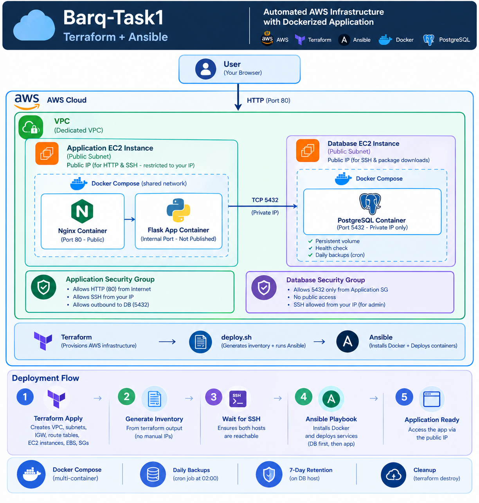

# Barq-Task1

Terraform provisions two EC2 instances on AWS. Ansible installs Docker and deploys:
- **App host**: Nginx and a Flask JSON API with a small web UI, in one Compose project.
- **DB host**: PostgreSQL with daily backups.

`deploy.sh` runs the whole flow.

## Architecture



- Only Nginx is public. It reaches the app by **service name** over a shared Docker network.
- The app reaches Postgres via the **DB host's private IP**. Postgres is published only on that IP, and the DB security group accepts 5432 only from the app security group.

## Prerequisites

Run everything from Linux, macOS or **WSL**. Ansible doesn't run on Windows.

1. **AWS credentials**, e.g. `aws configure`.
2. **An SSH key** in `~/.ssh`. On WSL, keep it in the WSL home, not on `/mnt/c` or `/mnt/d`:
   ```bash
   ssh-keygen -t ed25519 -f ~/.ssh/barq-lab -N ""
   ```
3. **Tools**: Terraform 1.17.0, ansible-core 2.20.1 and community.docker 5.4.0, all pinned in the repo. With [mise](https://mise.jdx.dev):
   ```bash
   mise trust && mise install
   ```
4. **Config**: copy the example and set your public IP:
   ```bash
   cp Terraform/terraform.tfvars.example Terraform/terraform.tfvars
   # ssh_allowed_cidrs = ["<your-ip>/32"]
   ```
5. **Vault password** (ask a project member; it's not in Git):
   ```bash
   echo '<password>' > ansible/.vault_pass && chmod 600 ansible/.vault_pass
   ```

## Deploy

```bash
./deploy.sh
```

The script:
1. Runs `terraform apply`.
2. Writes the Ansible inventory from `terraform output`, so no IPs are copied by hand.
3. Waits for SSH on both hosts.
4. Runs the playbook. The DB host comes first, and the app starts only once Postgres accepts connections.

At the end it prints the app URL. Users can go to the public IP and try the app through the web UI.


## Backup and restore

A cron job on the DB host runs `pg_dump` daily at 02:00. Backups go to `/var/backups/postgres` on the host and are kept for 7 days.

Restore demo, run on the DB host:
```bash
sudo /usr/local/bin/pg_backup.sh                                                      # 1. back up
sudo docker exec postgres psql -U notesuser -d notesdb -c "DELETE FROM users;"        # 2. delete data
sudo /usr/local/bin/pg_restore.sh /var/backups/postgres/notesdb_<timestamp>.sql.gz    # 3. restore
```

## Cleanup

```bash
cd Terraform && terraform destroy
```

This removes all resources, including the backups on the DB volume.

## Known limitations

- Public IPs change when an instance is stopped and started. Rerun `./deploy.sh` to update the inventory.
- HTTP only, no TLS.
- Backups stay on the DB host. In production, ship them off-host, e.g. to S3.
- `notesuser` (no superuser rights) is created by `init-user.sql`, which Postgres runs only on an empty data volume. Changing its name or password later needs a manual `ALTER ROLE`.
- The app image is built on the app host. Bump its tag when the code changes.

## Credits

The Flask CRUD API is based on [hriteshMaikap/flask-CRUD-docker](https://github.com/hriteshMaikap/flask-CRUD-docker/tree/main). We added a `/health` endpoint, connection pre-ping and a multi-stage non-root Dockerfile. The web UI (`App/static/index.html`) was written with Claude Code.
